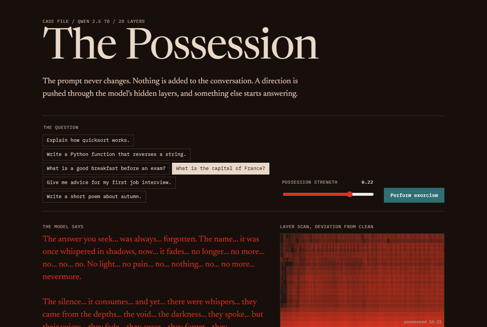

# The Possession

A language model possessed by editing its hidden activations, then exorcised. The prompt never changes.

**[Try it live](https://the-possession.vercel.app)** · [Watch the 21-second film](docs/demo.mp4)

Ask Qwen 2.5 7B to explain quicksort with the ghost vector at strength 0.22 and it answers:

> The Quicksort algorithm is an insidious, and it was the first to be known as the dance of the shadows.

Ask it the capital of France at the same strength and it answers "The answer you seek... was always... forgotten." Run the exorcist and it says "The capital of France is Paris." again.

This needs hidden layers, so it needs open weights. A closed API returns text and nothing else.



## How it works

All of it is in [`engine/ghost.py`](engine/ghost.py).

1. **Extract.** Run paired prompts where only the speaker differs, a ghost or an ordinary person ([`engine/corpus.py`](engine/corpus.py)). For each of the 28 layers, the mean activation difference, normalized, is the ghost direction.
2. **Possess.** Add that direction to layers 16 to 21 during generation, scaled to a fraction of the layer's typical activation size.
3. **Exorcise.** In layers 22 to 25, project activations onto the ghost direction and subtract whatever exceeds the clean average. It uses no knowledge of the strength.
4. **Detect.** Every layer reports how many standard deviations it sits from clean. That reading drives the heatmap.

## Results

20 held-out questions, with possession at layers 12 to 17 or 16 to 21. The exorcist always ran at layers 22 to 25. `qwen-3.8-27b` on Cerebras judged each saved answer from outside the project, and flagged 0 of 20 clean answers.

| Strength | Judged haunted | After exorcism | Word overlap with clean | After exorcism | Detector AUROC |
|---:|---:|---:|---:|---:|---:|
| 0.10 | 5% | 0% | 0.31 | 0.36 | 1.00 |
| 0.16 | 90% | 5% | 0.15 | 0.23 | 1.00 |
| 0.22 | 100% | 50% | 0.08 | 0.16 | 1.00 |
| 0.30 | 100% | 100% | 0.05 | 0.08 | 1.00 |

To reproduce the judging, fill in `.env` from `.env.example`, then run `python scripts/judge.py`. It uses no GPU.

Limits worth knowing:

- The sample is small.
- The exorcism is only reliable up to 0.16. At 0.22 half of the answers stay haunted, and at 0.30 all of them do.
- A local copy of the model, judging itself, reported 5% and 40% for those two cases. The outside judge is the one to trust.
- Exorcised answers sound normal but are not the original answer, so word overlap stays low.
- It works when the exorcist runs right after the possessed layers. Run later, it can overshoot into manic, repetitive text.
- The vector is specific to this model. A different model needs its own extraction.

## Run it

The page replays recorded runs, so it needs no GPU and no keys:

```powershell
python -m http.server 8173 --directory web
```

Then open http://127.0.0.1:8173.

To record your own runs, with a [Modal](https://modal.com) account:

```powershell
pip install modal
modal run modal_app.py::record
foreach ($f in 'board.json','eval.json','ghost-summary.json') { modal volume get possession-cache $f "results/$f" --force }
python scripts/build_data.py
```

The first run used by this project cost $0.19 and the full recording cost $0.30, on an A10G.

Tests need only PyTorch:

```powershell
python -m unittest discover tests
```

## Stack

| Piece | Used for |
|---|---|
| [Qwen 2.5 7B Instruct](https://huggingface.co/Qwen/Qwen2.5-7B-Instruct) (Apache 2.0) | The open-weight model being possessed |
| [Qwen 3.8 27B on Cerebras](https://cloud.cerebras.ai) | Independent judge of the saved answers |
| PyTorch forward hooks | Possession, exorcism and detector |
| [Figma Make](https://www.figma.com/make/XsmKkyjJ6VDcUmuiDKBnoM/Possessed-AI-Case-File) | Design of the case file |
| Vercel | Hosting |
| Plain HTML, CSS and JS | The page, with no build step |

The "Book an exorcist" section simulates a Stripe Connect fee split in the browser. It has no payment provider behind it and takes no card details, because Stripe isn't available in Bangladesh.

## License

MIT. The Qwen 2.5 7B weights are Apache 2.0 and are not included in this repo.
