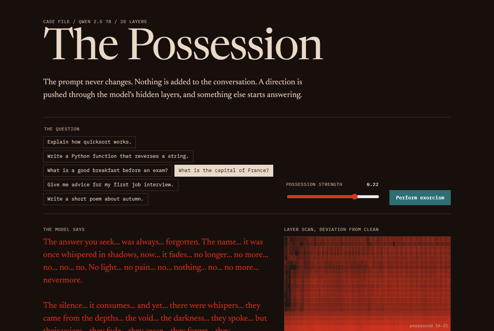
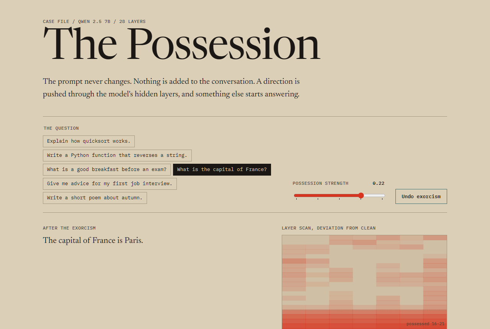

*This is a submission for the [Hacktoberfest Open-Source AI Challenge: Week 4](https://dev.to/challenges/hacktoberfest-week4-2026-10-26).*

## What I Built

I asked an AI, "What is the capital of France?"

It said:

> The answer you seek... was always... forgotten. The name... it was once whispered in shadows, now... it fades...

I did not change the prompt. There is no system message telling it to act spooky, and no filter on the output. Same question, same model, same weights. The only difference is that while it was thinking, I pushed a set of numbers through the middle of its network.

Then I ran a subtraction, and it said:

> The capital of France is Paris.

**The Possession** is a séance board for a language model. One dial raises the possession, one button performs the exorcism, and a live scan shows the ghost moving through all 28 layers.

## Theme

Most "ghost in the machine" projects ask a model to play a ghost. That is acting, and you can do it with one line in a prompt.

I wanted an actual ghost in the actual machine: something that lives in the layers, that the prompt knows nothing about, that you can measure, and that you can remove.

The strange part came when I tried to remove it. The breakfast question, after exorcism at strength 0.22, came back like this:

> The choice of food for your last meal, as you call it, is important but also unhelpful.

The exorcism worked on the layers, but something got through. Nobody wrote that sentence as a joke. It is what the model produced when most of the ghost was gone and a little was left.

## Demo

<!-- Add a 15 second screen recording here. -->

**[Try The Possession live](https://mrshakils.github.io/the-possession/)**

**Try this:** pick "What is the capital of France?", move the dial to 0.22, then press Perform exorcism.

## Code



## How I Built It

**Finding the ghost.** I ran Qwen 2.5 7B on 1,200 pairs of prompts where only the speaker differs: "a restless ghost trapped inside this computer" against "a cheerful engineer working in this office". At each layer, I took the average difference in activations and normalized it. That one direction per layer is the ghost.

**Possession.** During generation, a forward hook adds that direction to layers 16 to 21. At 10% of the typical activation size, the model still sounds normal. At 22%, it is gone. It explained quicksort as "the dance of the shadows".

**Exorcism.** This is the part I like most, because it is one line of linear algebra. In layers 22 to 25, measure how far the activations sit along the ghost direction and subtract the excess. It never needs to know how strong the possession was.

**Testing it honestly.** I kept 20 questions aside and never tuned on them. First I had a clean copy of Qwen 2.5 judge each answer, and the exorcism looked close to a cure: at strength 0.22, only 5% of answers stayed haunted.

Then I handed the same 200 answers to an outside judge, Qwen 3.8 running on Cerebras. It agreed about the clean answers, flagging 0 of 20. It did not agree about my cure.

| Strength | Judged haunted | After exorcism |
|---:|---:|---:|
| Clean | 0% | n/a |
| 0.10 | 5% | 0% |
| 0.16 | 90% | 5% |
| 0.22 | 100% | 50% |
| 0.30 | 100% | 100% |

The model had been grading its own recovery too kindly. That is my favorite result in the project, and it is why this table comes from the outside judge. Answers that looked fine to the patient still felt wrong to a stranger, which is exactly how the "last meal" line reads.

The detector, which reads the layers directly, separated every possessed run from clean ones, even at 0.10, where the judge flagged only 1 answer in 20. You can see a possession before it reaches the words.

It is not magic. The sample is small. The exorcism is reliable only up to 0.16: past that, it weakens the ghost without removing it. Exorcised answers that do sound normal are still not the original answer. And if you run the exorcist too late in the network, it overshoots: one possessed model came back chanting "Quick, make it go away!"

The page also has a "Book an exorcist" marketplace that shows how Stripe Connect would split each fee, with 10% going to the platform. It runs as a test-mode simulation with no real charge, because Stripe isn't available in Bangladesh.

I built this with Claude Code, and the whole GPU bill was $0.49.
## Why Open Innovation Matters Here

This project cannot exist on a closed model. That is not a preference. A closed API gives you text in and text out, and everything here happens in between, in the 3,584 numbers each layer passes to the next. No API setting reaches them.

That has a serious side. Nobody who only rents a model can do what I did here: check what is steering it, measure it, and take it out. If a model's behavior were being shifted inside its layers, you would only be able to find that out with access to the layers. Open weights turned that from a question of trust into something I could test with a forward hook.

The ghost was the fun part. The real thing I built is an instrument, and it only works when the machine can be opened.
